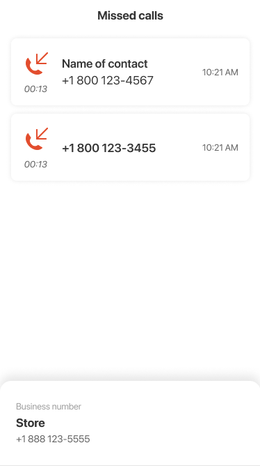

# nortCloud

## О проекте

Тестовое задание по iOS-разработке, 2022 год: список звонков и bottom sheet. В исходниках выделены ViewModel, Router и сервис работы со звонками.

Это исторический пример iOS/Android-кода. Основное текущее направление — Flutter / Dart; актуальный открытый Flutter-проект — [Objectno](https://github.com/nskomega/Objectno).

## Исходные материалы

Необходимо разработать экран со списком звонков по макету. 
При нажатии на элемент списка отобразить bottom sheet c информацией о бизнес-номере. 
Также необходимо реализовать механизм сохранения данных после загрузки, 
чтобы отображать их в случае отсутствия интернета, при этом приоритет у данных из сети. 
Предпочтительно использовать MVVM с репозиторием + верстка кодом.
